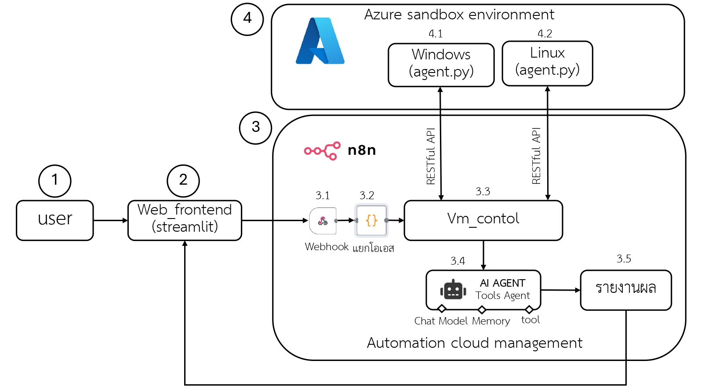
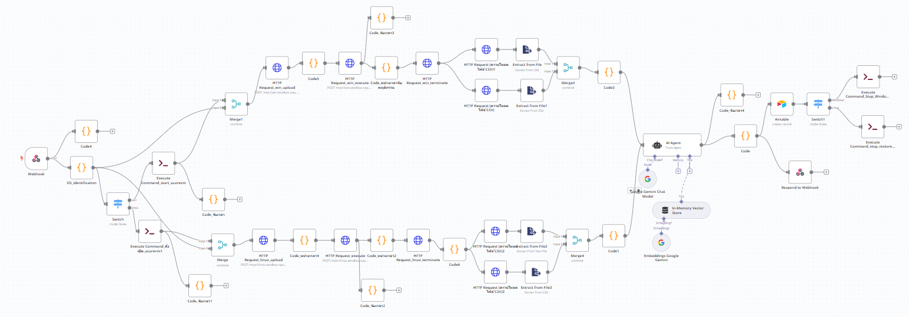
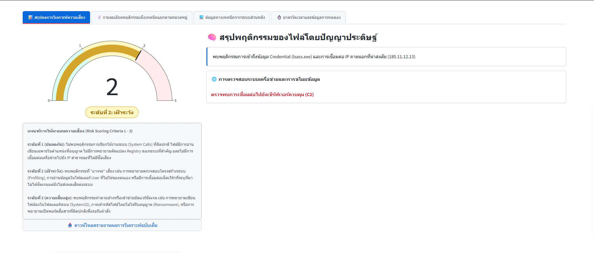

# Design and Implementation of an Endpoint Security System Using Large
Language Models for Cyber Threat Detection and Mitigation

[](https://www.python.org/)
[](LICENSE)
[](#security-focus)
[](https://github.com/kritt508/ai-edr-threat-detection-system/commits/main)

An automated malware analysis platform for Windows and Linux. It runs suspicious payloads in disposable Microsoft Azure VMs, collects endpoint and network telemetry, and uses Google Gemini with retrieval-augmented generation (RAG) to produce SOC reports mapped to MITRE ATT&CK.

## Results

- 85.33% overall detection accuracy across tested malware families and simulated threats.
- 95.00% recall for process injection, C2 beaconing, sandbox evasion, and abnormal outbound communication.
- Tested with APT-style simulations, RATs and stealers, Cobalt Strike-style beacons, IoT/Linux botnets, and evasion-focused samples.

## Capabilities

- Runs Windows `.exe` and `.bat` payloads, plus Linux `.elf` and `.sh` payloads, in isolated sandboxes.
- Automates ingestion, VM provisioning, execution, telemetry collection, reporting, and teardown through n8n.
- Collects endpoint telemetry with Procmon, Strace, Sysinternals, psutil, and process-tree analysis.
- Inspects network traffic with TShark and PCAP analysis for C2, beaconing, DGA-like patterns, and suspicious outbound traffic.
- Uses Gemini and RAG-based context to analyze behavior and map it to MITRE ATT&CK.
- Classifies activity as clean, infected, or a specific threat family or actor style when the evidence supports it.
- Produces analyst reports with risk scores, indicators, behavior summaries, and response recommendations.

## Workflow

```text
Malware Ingestion
      -> n8n SOAR Orchestrator
      -> Ephemeral Azure VM Provisioning
      -> Payload Detonation and Telemetry Monitoring
      -> Log Extraction and Sandbox Teardown
      -> Gemini Behavioral Analysis with RAG Context
      -> Threat Scoring and SOC Report Generation
```

## Architecture



Orchestration, sandbox execution, telemetry collection, analysis, and reporting run as separate stages. Disposable VMs isolate execution, and telemetry filtering removes noise from monitoring tools.

## Previews

### Automated SOAR workflow



### Threat analysis dashboard



## Security focus

The project supports defensive analysis through isolated malware execution, endpoint and network telemetry, noise filtering, MITRE ATT&CK mapping, and SOC-ready reports. Analysis infrastructure is torn down after execution.

> For authorized security research, malware-analysis education, and blue-team portfolio use. Never run unknown payloads outside a controlled, isolated lab.

## Tested threat categories

- APT-style behavior simulations, including APT29-inspired scenarios.
- RAT and stealer behavior, including ValleyRAT-style patterns.
- Cobalt Strike-style beaconing and command-and-control communication.
- Linux/IoT botnet behavior, including Mirai and Gafgyt-style variants.
- Evasion behavior such as sleep patching and environment checks.

## Tech stack

| Area | Tools |
| --- | --- |
| Backend and API | Python, Flask, Flask-CORS |
| Frontend and Dashboard | Streamlit, Plotly |
| AI Analysis | Google Gemini API, RAG-style contextual enrichment |
| SOAR and Orchestration | n8n |
| Sandbox Infrastructure | Microsoft Azure virtual machines, Docker-oriented deployment |
| Endpoint Telemetry | Procmon, Strace, Sysinternals, psutil |
| Network Telemetry | TShark, PCAP analysis |
| Data Processing | pandas, NumPy |
| Storage and Tracking | PostgreSQL, Airtable |

## Repository structure

```text
src/
  azure/        Azure VM control scripts and API server
  frontend/     Streamlit dashboard, analysis scripts, Docker setup, workflows
  n8n/          Windows and Linux telemetry filtering logic
  vm_linux/     Linux sandbox agent code
  vm_windows/   Windows sandbox agent code
docs/           Architecture and dashboard screenshots
```

## Setup

The project is designed for Linux or WSL-based security workflows.

### 1. Clone the repository

```bash
git clone https://github.com/kritt508/ai-edr-threat-detection-system.git
cd ai-edr-threat-detection-system
```

### 2. Create a Python environment

```bash
python -m venv .venv
source .venv/bin/activate
pip install -r requirements.txt
```

### 3. Configure environment variables

Create a `.env` file for local secrets and service configuration.

```bash
GEMINI_API_KEY=your_gemini_api_key
AZURE_SUBSCRIPTION_ID=your_azure_subscription_id
AZURE_RESOURCE_GROUP=your_resource_group
DATABASE_URL=your_database_url
```

Adjust variable names to match your local orchestration and deployment setup.

### 4. Run the dashboard

```bash
cd src/frontend
streamlit run app.py
```

### 5. Run the Azure control API

```bash
python src/azure/api_server.py
```

## License

This project is licensed under the MIT License. See [LICENSE](LICENSE) for details.
